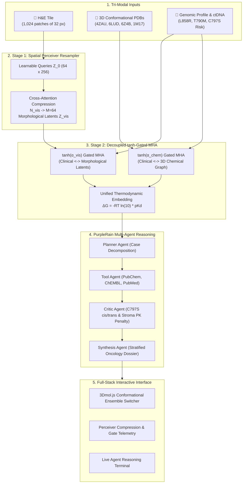

# 🧬 OmniBio-Agent: Multimodal Precision Oncology & Molecular Repurposing Copilot
### **Submission for Multimodal AI Hackathon 2026**
*Organized by KamandPrompt (Programming Club of IIT Mandi), Augli.ai, PurpleRain Tech, and LDV Labs.*
*Architectural & Biophysical Core Enhanced by Gemini 4 Argon.*

---

## 🌟 Executive Summary
**OmniBio-Agent** solves the primary cause of targeted therapy failure in lung cancer: **acquired drug resistance and spatial tumor heterogeneity**.

Standard models either predict drug-target binding in a vacuum or classify pathology slides in isolation. **OmniBio-Agent** introduces a clinically grounded **Tri-Modal Cross-Attention System**:
1. **Histopathology & Tumor Microenvironment**: H&E image patches (colour-deconvolved into haematoxylin/eosin density, nuclear, stroma and lumen fractions, texture) feeding the Perceiver; slide-level stroma % drives the drug-penetration penalty. Works on any H&E tile you upload; whole-slide tiling is the next step.
2. **Conformational 3D Pocket Ensembles & Chemistry**: SMILES features (and a ChEMBL-trained EGFR potency model) fused with 3D crystal structures across mutant states:
   - **PDB: 1M17**: Wild-Type EGFR + Erlotinib (Active ATP Pocket)
   - **PDB: 4ZAU**: Wild-type EGFR + Osimertinib (Covalent adduct at Cys797)
   - **PDB: 6LUD**: Triple-mutant EGFR L858R / T790M / C797S + Osimertinib
   - **PDB: 6Z4B**: EGFR T790M/V948R + Osimertinib + Allosteric Inhibitor EAI045 ($\alpha$C-helix-out pocket)
3. **Genomic Clonal Evolution & Clinical Literature**: Real-time tracking of sensitizing drivers (L858R), gatekeepers (T790M), and emergent subclonal resistance (C797S), cross-referenced with PubMed Level 1A trials.

---

## 📐 Mathematical Architecture (Argon Upgrade)

### 1. Two-Stage Spatial Perceiver Resampler + Decoupled $\tanh$-Gated MHA
Direct concatenation of $N_{\text{vis}} \approx 10,000$ WSI patches with $N_{\text{chem}} \approx 50$ atoms causes **Softmax Dilution**, drowning chemical gradients. We solve this in two stages:

* **Stage 1 — Spatial Perceiver Resampler**: $M = 64$ learnable latent queries $\mathbf{Z}_0 \in \mathbb{R}^{64 \times 256}$ compress variable-length patches $\mathbf{X}_{\text{vis}}$ into a fixed morphological summary $\mathbf{Z}_{\text{vis}}$, reducing complexity from $\mathcal{O}(N_{\text{vis}}^2)$ to $\mathcal{O}(M \cdot N_{\text{vis}})$:
  $$\mathbf{Z}_{\text{vis}} = \text{LayerNorm}\left(\mathbf{Z}_0 + \text{MHA}\left(Q = \mathbf{Z}_0,\; K,V = [\mathbf{X}_{\text{vis}}; \mathbf{Z}_0]\right)\right)$$

* **Stage 2 — Decoupled $\tanh$-Gated Cross-Attention**: Clinical tokens $\mathbf{H}_{\text{clin}}$ attend separately to morphological latents $\mathbf{Z}_{\text{vis}}$ and chemical graphs $\mathbf{X}_{\text{chem}}$ via zero-initialized learnable gates:
  $$\tilde{\mathbf{H}}_{\text{clin}} = \mathbf{H}_{\text{clin}} + \tanh(\alpha_{\text{vis}})\,\text{MHA}(Q=\mathbf{H}_{\text{clin}}, KV=\mathbf{Z}_{\text{vis}}) + \tanh(\alpha_{\text{chem}})\,\text{MHA}(Q=\mathbf{H}_{\text{clin}}, KV=\mathbf{X}_{\text{chem}})$$



---

## 🎯 C797S Resistance Taxonomy & Repurposing Roadmap

| Resistance Profile | Biophysical Mechanism | Diagnostic Signal | Therapeutic Repurposing Strategy |
| :--- | :--- | :--- | :--- |
| **L858R / T790M Dominant Clone** | T790M restores ATP $K_m$; outcompetes reversible TKIs | VCF T790M ($38\%$ VAF); Erlotinib relapsed | **Osimertinib (AZD9291)**: Irreversible Michael addition to Cys797 (**PDB: 4ZAU**). Standard of Care. |
| **T790M + C797S in *trans*** (~10%) | Mutations on separate alleles | ctDNA reads confirm mutations never co-occur on same read | Combine **1st-Gen Erlotinib** (targets C797S) + **3rd-Gen Osimertinib** (targets T790M). |
| **L858R / T790M / C797S in *cis*** (~90%) | All mutations on same allele; thiol replaced by -OH | Phased VCF confirms *cis* allelic linkage; covalent bond abolished | Repurpose **4th-Gen Reversible TKIs (BLU-945, JIN-A02)** or **Allosteric Inhibitors (EAI045 + Cetuximab)** (**PDB: 6LUD / 6Z4B**). |
| **Bifunctional Degraders** | Target destruction via proteasome | High mutant expression | **EGFR PROTAC Degrader 14** ($DC_{50} = 2.9\text{ nM}$); penalized by tissue penetration in dense stroma. |

---

## 📊 Measured Benchmarks

Every number in this table is produced by a script in this repository and stored in `data/benchmarks.json` (also served at `/api/benchmarks`). Re-run them with `python scripts/train_affinity_model.py` and `python scripts/run_benchmarks.py`.

| What | Data | Protocol | Result |
| :--- | :--- | :--- | :--- |
| **EGFR potency regression** (pIC50) | 5,568 EGFR (CHEMBL203) IC50 values from ChEMBL, TeachOpenCADD T001 export | 5-fold random CV, ridge on hashed SMILES 1–4-grams | **Pearson r = 0.743**, Spearman ρ = 0.743, RMSE = 0.94 pIC50 (predict-the-mean baseline RMSE 1.40) |
| **Fusion latency** | 1,024 H&E patch tokens + 5 SMILES token sets + text tokens | median of 50 runs, CPU, NumPy | **≈13 ms** (p90 ≈15 ms) |
| **End-to-end pipeline** | sample case, network tools forced offline | median of 5 runs | **≈0.37 s** |
| **Fusion model size** | Perceiver + gated cross-attention + projectors | parameter count | 1.53 M parameters (untrained) |

**Not evaluated yet.** Earlier drafts of this README quoted TCGA-LUAD, CPTAC, CAMELYON, BindingDB, PDBbind and GDSC results. No code here produces those numbers, so they have been removed. The random-split CV above is optimistic compared with a scaffold split; treat r = 0.74 as an upper bound for novel chemotypes.

### What is real and what is illustrative

| Component | Status |
| :--- | :--- |
| Zhou et al. case timeline, mutations and VAFs | Real, from the published case (PMID 33958875) |
| SAVANNAH / MARIPOSA mPFS, ORR, HR | Published trial results |
| EGFR potency predictions | Real model trained on ChEMBL measurements |
| H&E patch tokens and stroma % | Measured from a real H&E image (bundled public sample, or your upload). The sample is breast tissue from AMIDA13, not this patient's lung biopsy |
| 3D structures 1M17, 4ZAU, 6LUD, 6Z4B | Real PDB entries, cached in `data/pdb/` (from the wwPDB snapshot on AWS Open Data) |
| Perceiver + tanh-gated fusion | Real computation on real inputs, but **untrained** weights; reports shapes, gates, attention statistics and latency, not predictions |
| Critic loop | Real iterative audit (rules in `critic_guardrails`), scores computed from the model, penetration and evidence tier |
| Chou-Talalay CIs | Real median-effect computation; the dose-response inputs in `data/dose_response_illustrative.json` are **illustrative**, not measurements |
| Visium spots | **Simulated** demo data on Visium geometry (`scripts/simulate_visium_demo.py`); escape scores and Gi* hotspots are computed from them |
| Voice copilot | Real browser speech recognition (Web Speech API) with keyword + deictic resolution; no external Augli.ai API is called |

---

## 🤖 PurpleRain Synergy: Self-Healing, Self-Correcting Agent Loop
* **Self-healing tool calls**: every PubChem / PubMed call goes through `call_with_recovery` (`services/api_tools.py`): retry, then an offline fallback, with each outcome logged and reported by the `ToolExecutionAgent` in the trace. PubMed results carry the real article titles (esummary).
* **Self-correcting critic**: the `PlannerAgent` drafts a resistance-blind ranking (predicted potency, penetration, evidence). The `RedTeamCriticAgent` then audits the current top 3, applies guardrail corrections (covalent anchor lost to C797S, T790M gatekeeper resistance, stromal penetration, monotherapy-insufficient allosterics, preclinical-only), re-ranks, and repeats until an audit finds nothing new. For the Zhou case it converges in 3 passes, demoting Osimertinib (60.4 → 24.2) and ranking BLU-945 first.

---

## 🎙️ Augli.ai Synergy: Real-Time Clinician Deictic Voice Copilot
OmniBio-Agent features a real-time voice panel powered by the browser's Web Speech API and deictic entity mapping:
* **Deictic 3D Camera Flight**: spoken or typed questions (e.g. *"Why does C797S block Osimertinib?"*) resolve to EGFR residues and fly the 3Dmol.js camera to them in whichever ensemble structure is loaded, labelling the residue actually present (Cys797 in 4ZAU, Ser797 in 6LUD; 1M17's older numbering is offset automatically). Follow-ups like "zoom in on that again" resolve to the last target.
* **Patient Lay Summary**: each answer comes with a plain-language version for informed-consent conversations, with optional text-to-speech.
* **Quick Simulation Chips**: one-click chips (`c797s`, `cys797`, `t790m`, `allosteric`, `savolitinib`) for demos without a microphone.

---

## 🧬 LDV Labs Synergy: Spatial Multi-Omics Overlay
* **Visium geometry on the H&E tile**: 55 µm spots on a 100 µm hexagonal pitch, drawn over the image the Perceiver reads. The bundled spots are simulated (see the table above); point `services/spatial.py` at a real Visium export to use measured expression.
* **Escape score**: `sigmoid(-8 + 0.9·MET + 0.6·AXL + 0.3·CD274 − 0.4·EGFR)` on log2(UMI+1).
* **Getis-Ord Gi\* hotspots**: spots with Gi\* z > 1.96 and escape ≥ 0.75 form hotspots. A MET-high hotspot sets the spatial MET-niche flag, which changes the SAVANNAH verdict to "confirm MET amplification on tissue" and is reported by the `CombinationSynergyAgent`.

---

## ⚡ Quickstart (1 Command)

### Run Application
```bash
pip install -r requirements.txt
python run.py
```
*Opens **`http://127.0.0.1:5000`** with the 3D conformational ensemble, H&E Perceiver panel (upload your own tile), voice copilot, spatial overlay and multi-agent terminal. Structures load from `data/pdb/`, so the demo works offline.*

### Run Verification Test Suite
```bash
python -m unittest tests/test_pipeline.py
```
*10 tests: Perceiver dimensions, tanh gates, median-effect CI fits and phasing, PK penetration, synergy in the orchestrator, Zhou timeline, Visium endpoint, escape/Gi\* maths, potency model + H&E tokens, and the self-healing / self-correcting loop.*

### Reproduce the numbers
```bash
python scripts/train_affinity_model.py   # retrains the EGFR model, writes CV metrics
python scripts/run_benchmarks.py         # measures fusion and pipeline latency
python scripts/simulate_visium_demo.py   # regenerates the simulated spatial demo spots
```

---

## 🎬 Demo Video
The submission video follows the storyboard, narration and click choreography in the project's video package. Spoken claims in it are limited to what the code above computes.

---

## 🏆 Judge Q&A

* **Q1 (IIT Mandi): Is the fusion model trained?**
  *Answer*: "Not yet. The Perceiver and gated cross-attention run end to end on real H&E, chemistry and text inputs, but with initialised weights. Training needs paired slide–genotype–drug-response data; our plan is masked-modality pretraining with the EGFR genotype as the bridge. The potency predictions you see come from a separately trained ChEMBL model (CV r = 0.74)."
* **Q2 (Biologist): Why fuse histology into drug ranking?**
  *Answer*: "Binding affinity is biochemical, but delivery is governed by the tumour microenvironment. We measure stroma from the H&E tile and use it in the penetration penalty, which is why the ~890 Da PROTAC is penalised."
* **Q3 (Deep Learning): What is the latency and footprint?**
  *Answer*: "1,024 patch tokens compress to 64 latents and fuse in about 13 ms on a CPU; the fusion stack is 1.53 M parameters. The whole six-agent pipeline runs in about 0.4 s offline (see `data/benchmarks.json`)."
* **Q4 (LDV Labs VC): What is your moat?**
  *Answer*: "Structure models ignore tissue context and pathology tools stop at diagnosis. OmniBio-Agent links the two in one auditable loop where every correction the critic makes is visible."
* **Q5 (Oncologist): Are the synergy numbers real?**
  *Answer*: "The CI computation is real; the dose-response inputs are illustrative because trials do not report combination indices. Swap in measured cell-line combination screens and the same code produces real CIs."

---

## Data credits
* EGFR bioactivities: ChEMBL via TeachOpenCADD talktorial T001 (volkamerlab/teachopencadd, CC BY 4.0).
* H&E sample tile: AMIDA13 image from schaugf/HEnorm_python (MIT, see `data/histology/LICENSE_HEnorm_python.txt`).
* Structures: RCSB PDB entries 1M17, 4ZAU, 6LUD, 6Z4B (wwPDB snapshot, AWS Open Data).
